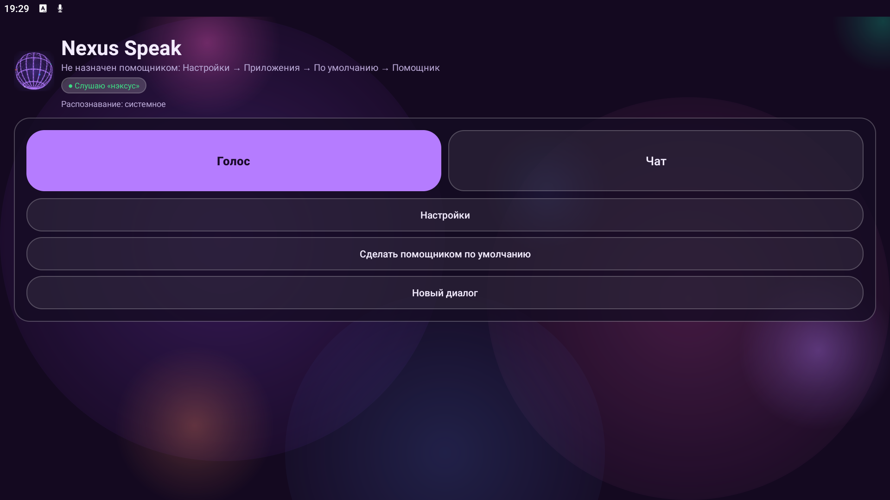
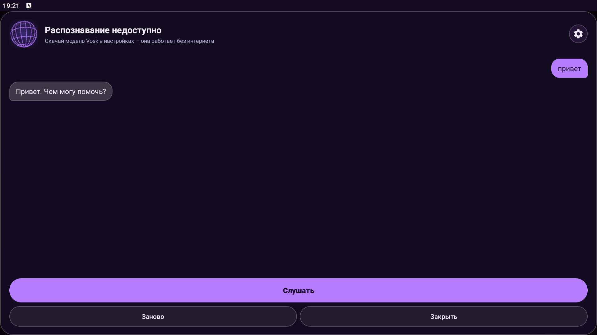
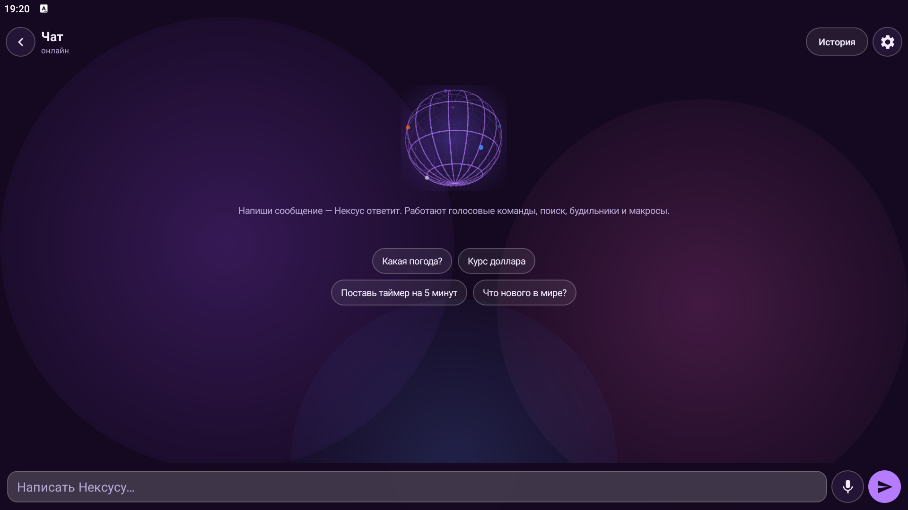
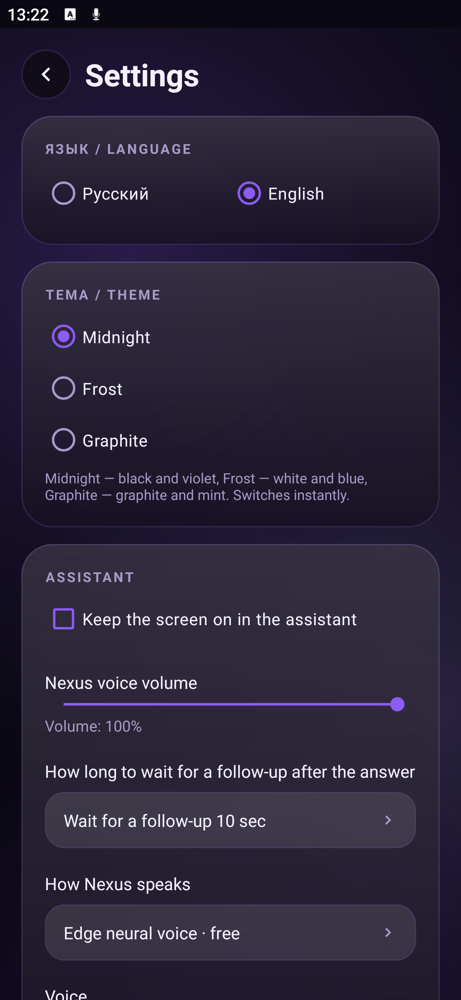
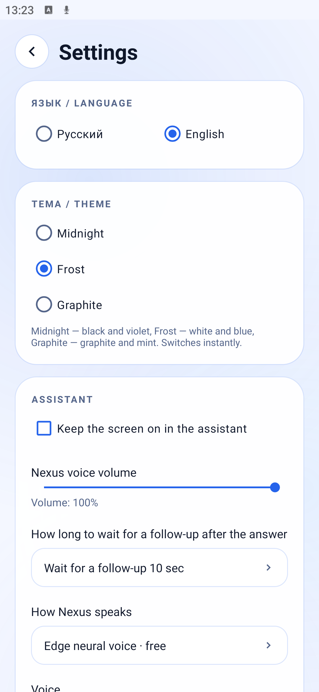
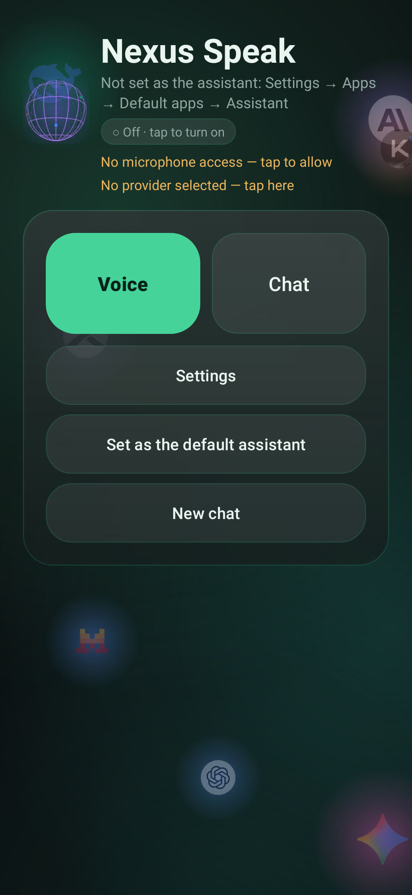

# Nexus Speak 🟣

Russian-speaking voice assistant for Android with a bilingual (Russian / English) interface. Wake word «Нэксус», hands-free conversation, streaming chat and phone control, on top of any OpenAI-compatible LLM.

  
  
  

| Midnight | Frost | Graphite |
|---|---|---|
|  |  |  |

**Nexus Speak** is a Russian-speaking voice assistant for Android. Say the wake word «Нэксус» and talk — it answers out loud, keeps the conversation, and can control the phone. Any OpenAI-compatible LLM provider works.

**The interface is bilingual (Russian / English).** Open Settings → «Язык / Language» → **English** and the whole app — main screen, assistant panel, chat, settings, notifications and toasts — switches immediately, no restart. On first launch the app follows the system language: Russian if the phone is Russian, English otherwise.

- Wake word, hands-free voice mode, streaming answers spoken while they arrive.
- Android Assistant integration: it can take over the long-press assistant gesture.
- Text chat with history, per-dialog memory, voice and cloud TTS (Microsoft Edge neural voices, Google, ElevenLabs, Yandex SpeechKit).
- Phone control tools: timers, alarms, calls, messages, volume, flashlight, app launch.
- Bring your own key: no key, no provider and no telemetry inside the build.

**Install:** download `Nexus.apk` from [Releases](https://github.com/roma1231jjj-cpu/nexus-speak/releases/latest), allow installation from unknown sources, install, then open Settings → provider → paste your API key. Android 13+ is recommended.

**Privacy:** the app talks only to the provider you configure and to the TTS service you pick. Keys stay in the app's private preferences on the phone.

**Screenshots above** are the app itself: Settings in Midnight, Settings in Frost and the main screen in Graphite, interface switched to English.

**Themes:** three named palettes, switched in Settings → «Тема / Theme» — **Midnight** (black + violet #8B5CF6), **Frost** (white + blue #2563EB) and **Graphite** (graphite + mint #46D39A). The choice is applied instantly with `recreate()`, never restarts the app, and follows the whole interface: main screen, assistant panel, chat, settings, dialogs, status bar and system widget tints.

**Language:** Settings → «Язык / Language» — Русский / English. The choice is saved and applied instantly (`recreate()`), no app restart, no re-login. Voice recognition and TTS stay on the system languages — the switch only changes the UI, so a Russian voice engine keeps speaking Russian.

**Build:** JDK 17, Android SDK, `gradle assembleRelease`. The APK is signed with a debug key for distribution as a side-loaded build.

The rest of this README is in Russian — ask in the issues if you need an English guide for a specific screen.

## Install

1. Download **[Nexus.apk](https://github.com/roma1231jjj-cpu/nexus-speak/releases/latest)**.
2. Allow installing from unknown sources and install it.
3. Android 13+ (works on 8–12, with fewer features).
4. Open **Settings → provider** → pick one from the list or type your own base URL → paste your own API key.
5. Models and prices load automatically. Then press **«Make default assistant»**.

## Supported providers (OpenAI-compatible)

Polza.ai · OpenRouter · OpenAI · DeepSeek · Groq · Mistral · Together AI · Google Gemini · local server (LM Studio / Ollama) · any custom endpoint.

Point it at a URL and the app detects the provider, tries `/models`, loads the model list with prices per million tokens, and picks a chat model plus a vision model.

Updates arrive by themselves: the app reads `update.json` in this repository, asks before downloading, shows progress and asks to confirm the install.

## Everything in the language you choose

Language lives in Settings → «Язык / Language»: Русский / English. The switch is instant (`recreate()`), saved between launches, and covers the main screen, the assistant panel, chat, settings, dialogs, toasts, the wake notification and every status string that appears later. Russian or English voice commands both work, and speech recognition follows the interface language.

Themes: **Midnight** (black + violet), **Frost** (white + blue), **Graphite** (graphite + mint) — Settings → «Тема / Theme».

## Build

JDK 17, Android SDK, `gradle assembleRelease`. The published APK is signed with a debug key, as a side-loaded build.

Русская документация — в [README.md](README.md).
