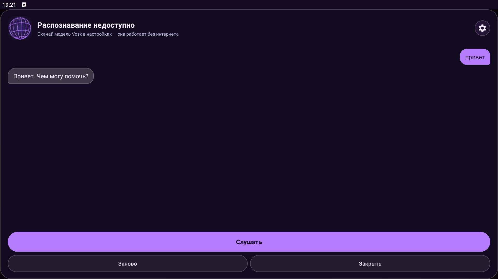
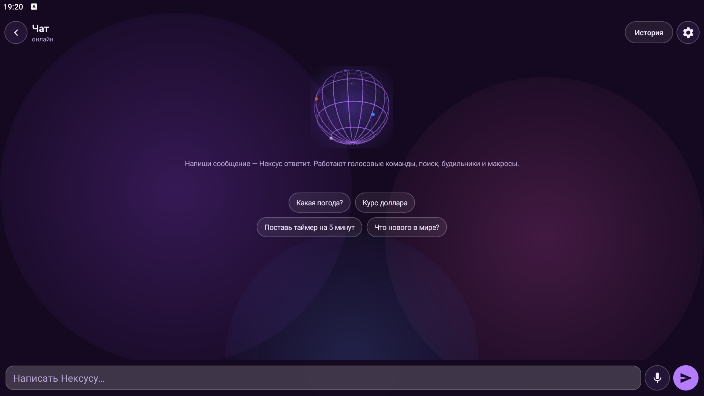

# Nexus Speak 🟣

Русский голосовой ассистент для Android: wake-слово **«Нэксус»**, разговор голосом, чат с потоковыми ответами и управление телефоном. Работает поверх любого LLM через OpenAI-совместимый API (по умолчанию — DeepSeek через Polza.ai).

<p>
  
  
  
</p>

## Установка

1. Скачай **[Nexus.apk](https://github.com/roma1231jjj-cpu/nexus-speak/releases/latest)** (или из [Releases](https://github.com/roma1231jjj-cpu/nexus-speak/releases)).
2. Разреши установку из неизвестных источников и поставь APK.
3. Android 13+ (на 8–12 запускается, но без части фишек).
4. Открой **Настройки → «Выбрать провайдера»** → выбери из списка или введи свой адрес → вставь свой API-ключ.
5. Модели и цены подтянутся автоматически. Нажми **«Сделать помощником по умолчанию»**.

## 🔐 Ключи и приватность

В этой сборке **нет ни API-ключа, ни провайдера по умолчанию** — только код приложения.
Ключ вводится вами в настройках и лежит в приватных настройках приложения на телефоне.
Приложение не отправляет данные никуда, кроме выбранного вами провайдера.

## Поддерживаемые провайдеры (OpenAI-совместимые)

Polza.ai · OpenRouter · OpenAI · DeepSeek · Groq · Mistral · Together AI · Google Gemini · локальный сервер (LM Studio / Ollama) · любой свой адрес.

Достаточно указать адрес — приложение само определит провайдера, попробует `/models` и `/v1/models`, загрузит список моделей, цены за миллион токенов и автоматически подставит модель для ответов и vision-модель.

Обновления приходят сами: приложение проверяет `update.json` в этом репозитории, спрашивает разрешение на скачивание, показывает прогресс и просит подтвердить установку.

## Как позвать

| Способ | Что работает |
|---|---|
| Фраза «**Нэксус** …» | «Нэксус, который час», «Нэксус, включи фонарик» |
| Кнопка/жест ассистента | долгое нажатие кнопки питания или жест навигации |
| Кнопка на наушниках | если Nexus Speak назначен помощником по умолчанию |
| Иконка приложения | большой экран с режимами «Голос» и «Чат» |

Варианты произношения, которые понимает wake-слово: `нэксус`, `нексус`, `нэкси`, `некси`, `нэкс`, `некс`, `nexus`.

## Возможности

### Диалог
- **Два режима**: 🎤 «Голос» (оверлей поверх любого приложения) и 💬 «Чат» (переписка с историей).
- **Потоковые ответы** — текст появляется по мере генерации, озвучка идёт по предложениям.
- **Пузырьки как в мессенджере**: твои справа, ответы Нэксуса слева.
- **Несколько сессий**: история диалогов, автозаголовки, переключение и удаление.
- **Настройка голоса**: выбор установленного русского голоса, скорость речи и тон + проверка звучания.
- **Память о тебе**: блок «Что Нэксус знает о тебе» — факты подмешиваются в каждый запрос. ИИ умеет вести её сам: «запомни, что я не люблю звонки», «что ты обо мне помнишь?», «забудь про работу».
- **Персонаж**: 7 встроенных характеров (краткий, дружелюбный, секретарь, технарь, переводчик, детский) + свои промпты. Скрытый системный промпт не редактируется и не показывается.
- **Макросы** — свои фразы-команды: открыть приложение, ссылку, фонарик, громкость, таймер, пауза.
- **Пауза и продолжение**: кнопка «Пауза», авто-пауза после двух пустых ходов, голосовые «пауза», «стоп», «заново».
- **Окно разговора**: сколько секунд ждать продолжения после ответа (сразу / 10 / 20 / 30 / 60 сек).

### Управление телефоном
- Открытие приложений, ссылок, поиск в интернете.
- Фонарик, громкость, будильники и таймеры, звонки и SMS, контакты.
- Чтение экрана (скриншот → vision-модель): «что на экране?».
- Погода, курсы, новости — через встроенный веб-инструмент.

### Автономность
- **Wake-слово** без интернета через офлайн-модель Vosk (скачивается из приложения, ~45 МБ).
- **Чтение уведомлений** вслух с фильтром спама и тихими часами (23:00–08:00).
- **Кто звонит** — объявляет имя из контактов.
- **Автоответчик на звонки**: через N секунд поднимает трубку, говорит приветствие и кладёт (Android не даёт приложению слушать аудио звонка).
- Плитка в шторке: включить/выключить прослушку одним тапом.

### Настройка моделей
- Каталог моделей с ценами в ₽ прямо от провайдера.
- Отдельные модели: текст, fallback, vision, vision-fallback — всё через поиск и выбор, без ручного ввода ID.
- Учёт расходов за день.

### Внешний вид
- Тёмная, светлая и системная темы + **AMOLED** (чистый чёрный).
- Живой 2.5D-глобус, плавающие орбы с настоящими логотипами провайдеров (Anthropic, OpenAI, Gemini, DeepSeek, Kimi, Grok, Mistral, Qwen).
- Настройки — отдельным экраном, главный экран короткий: статус, «Голос», «Чат».

## Почему в системе не видно «Nexus» в «Распознавании и синтезе речи»

Этот список показывает **движки** (Google TTS, Google-распознавание, Vosk). Nexus Speak — не движок, а приложение-ассистент, поэтому его там нет и быть не должно. Если системного распознавания на телефоне нет (частая история на Honor/MagicOS), включи офлайн-модель Vosk: **Настройки → Прослушка → Скачать модель Vosk**, после этого Нэксус слышит без интернета и без Google.

Проверить, слышит ли телефон вообще: **Настройки → «Проверить распознавание речи»** — покажет распознанный текст или код ошибки.

## Как вернуть выбор ИИ при зажатии

Android показывает список приложений, только когда помощник не назначен жёстко. В приложении есть
**Настройки → «Сбросить чужого помощника (Алису)»** и **«Как вернуть выбор ИИ при зажатии»** —
они открывают нужные экраны системы. Короткая версия:

1. У Алисы/Яндекса: Настройки приложения → **По умолчанию → Сбросить настройки**.
2. В системе: Настройки → Помощник → **«Нет» / «Не назначено»**.
3. Зажать кнопку ещё раз → Android спросит «чем открыть» → **Nexus Speak** и «Всегда».

## Если на наушниках открывается Алиса

Кнопка на наушниках запускает **системного** помощника. Если им назначена Алиса (Яндекс), она и открывается, сколько бы ни было настроено в Nexus Speak. Нужно поменять системного помощника:

- **Honor / MagicOS**: Настройки → Приложения → Приложения по умолчанию → Помощник → Nexus Speak.
- Если пункта нет: Настройки → Google → Поиск, Ассистент и Голос → Google Ассистент → отключить, затем назначить Nexus Speak.
- На некоторых прошивках кнопка наушников жёстко привязана к приложению производителя и переназначить её нельзя — тогда остаётся жест/кнопка помощника.

## Сборка

```bash
cd assistant
gradle wrapper --gradle-version 8.7   # один раз
./gradlew assembleRelease
```

Java-only, без Compose. `minSdk 33`, `targetSdk 34`.

## Ограничения (честно)

- Android не даёт приложению доступ к аудио звонка — «автоответчик» умеет только приветствие и сброс.
- Голос берётся из системного TTS. Если русского голоса нет — Нэксус прямо об этом скажет и предложит открыть настройки синтеза.
- Токены тратятся на каждый запрос, включая шутки и погоду.

## Что нового

**1.7.0 (фикс)** — облачные голоса (OpenAI gpt-4o-mini-tts, ElevenLabs, Яндекс SpeechKit) вместо робота, Vosk убран из приложения, починено постоянное прослушивание (сервис больше не «зависает» в паузе), голос в уведомлениях больше не звучит «из трубки», APK похудел с 49 МБ до 11 МБ.

**1.6.2 (фикс)** — исправлены: «Слушать постоянно» больше не выключается само, офлайн-пробуждение Vosk реально работает, Nexus Speak может стать системным помощником, копия настроек действительно сохраняется, выбранный голос не сбрасывается. Плюс живой статус прослушки в настройках и аккуратный главный экран.

**1.6.1** — панель Нэксуса теперь выезжает снизу компактным чатом поверх любого приложения (как у Алисы), одно нажатие для скачивания офлайн-распознавания, «Слушать постоянно» больше не выключается само.

**1.6.0** — настройки голоса (тембр, скорость, тон), автобэкап настроек при обновлениях, инструмент геолокации, проверка доступа к телефону, вотчдог прослушки в фоне.

**1.5.0** — ИИ сам ведёт память о пользователе (инструмент remember/forget), убраны дубли настроек, исправлено определение помощника по умолчанию, убрана бесполезная кнопка сброса чужого помощника, подсказка про отсутствующий TTS с установкой «Речевых служб Google».

**1.4.2** — установка обновлений больше не падает: PackageInstaller-сессия вместо content://, проверка разрешения «установка из неизвестных источников», автоповтор после выдачи, понятные ошибки вместо краша.

**1.4.0** — приложение называется Nexus Speak, wake-слово «Нэксус» (+ варианты), кнопка прослушки честно включает/выключает сервис, статус распознавания на главном экране, тест распознавания в настройках, авто-скачивание Vosk, отдельный экран настроек, реальные логотипы провайдеров, пузырьки в голосовом режиме, починена озвучка.

**1.3.1** — убраны ИИ-автоответы, окно разговора, тихие часы, чистка истории, чипы в чате.

**1.2.0** — AMOLED, автоответчик на звонки.

**1.1.0** — чат и голос, стриминг, сессии, память, макросы, плитка в шторке.
