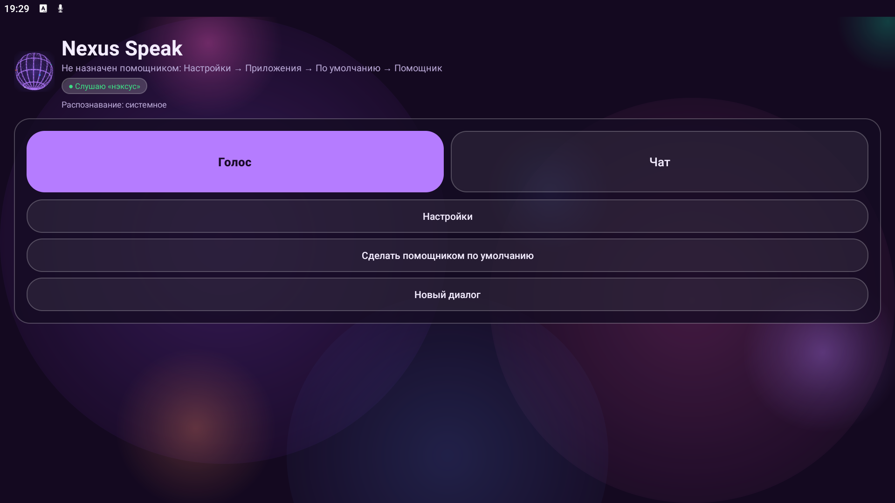

# Nexus Speak 🟣

Русский голосовой ассистент для Android: wake-слово **«Нэксус»**, разговор голосом, чат с потоковыми ответами и управление телефоном. Работает поверх любого LLM через OpenAI-совместимый API (по умолчанию — DeepSeek через Polza.ai).

<p>
  
  
  
</p>

## English

**Nexus Speak** is a Russian-speaking voice assistant for Android. Say the wake word «Нэксус» and talk — it answers out loud, keeps the conversation, and can control the phone. Any OpenAI-compatible LLM provider works.

- Wake word, hands-free voice mode, streaming answers spoken while they arrive.
- Android Assistant integration: it can take over the long-press assistant gesture.
- Text chat with history, per-dialog memory, voice and cloud TTS (Microsoft Edge neural voices, Google, ElevenLabs, Yandex SpeechKit).
- Phone control tools: timers, alarms, calls, messages, volume, flashlight, app launch.
- Bring your own key: no key, no provider and no telemetry inside the build.

**Install:** download `Nexus.apk` from [Releases](https://github.com/roma1231jjj-cpu/nexus-speak/releases/latest), allow installation from unknown sources, install, then open Settings → provider → paste your API key. Android 13+ is recommended.

**Privacy:** the app talks only to the provider you configure and to the TTS service you pick. Keys stay in the app's private preferences on the phone.

**Build:** JDK 17, Android SDK, `gradle assembleRelease`. The APK is signed with a debug key for distribution as a side-loaded build.

The rest of this README is in Russian — ask in the issues if you need an English guide for a specific screen.

## Установка (по-русски)

1. Скачай **[Nexus.apk](https://github.com/roma1231jjj-cpu/nexus-speak/releases/latest)** (или из [Releases](https://github.com/roma1231jjj-cpu/nexus-speak/releases)).
2. Разреши установку из неизвестных источников и поставь APK.
3. Android 13+ (на 8–12 запускается, но без части фишек).
4. Открой **Настройки → «Выбрать провайдера»** → выбери из списка или введи свой адрес → вставь свой API-ключ.
5. Модели и цены подтянутся автоматически. Нажми **«Сделать помощником по умолчанию»**.

## 🔐 Ключи и приватность

В этой сборке **нет ни API-ключа, ни провайдера по умолчанию** — только код приложения.
Ключ вводится вами в настройках и лежит в приватных настройках приложения на телефоне.
Приложение не отправляет данные никуда, кроме выбранного вами провайдера.

## Поддерживаемые провайдеры (OpenAI-совместимые)

Polza.ai · OpenRouter · OpenAI · DeepSeek · Groq · Mistral · Together AI · Google Gemini · локальный сервер (LM Studio / Ollama) · любой свой адрес.

Достаточно указать адрес — приложение само определит провайдера, попробует `/models` и `/v1/models`, загрузит список моделей, цены за миллион токенов и автоматически подставит модель для ответов и vision-модель.

Обновления приходят сами: приложение проверяет `update.json` в этом репозитории, спрашивает разрешение на скачивание, показывает прогресс и просит подтвердить установку.

## Как позвать

| Способ | Что работает |
|---|---|
| Фраза «**Нэксус** …» | «Нэксус, который час», «Нэксус, включи фонарик» |
| Кнопка/жест ассистента | долгое нажатие кнопки питания или жест навигации |
| Кнопка на наушниках | если Nexus Speak назначен помощником по умолчанию |
| Иконка приложения | большой экран с режимами «Голос» и «Чат» |

Варианты произношения, которые понимает wake-слово: `нэксус`, `нексус`, `нэкси`, `некси`, `нэкс`, `некс`, `nexus`.

## Возможности

### Диалог
- **Два режима**: 🎤 «Голос» (оверлей поверх любого приложения) и 💬 «Чат» (переписка с историей).
- **Потоковые ответы** — текст появляется по мере генерации, озвучка идёт по предложениям.
- **Пузырьки как в мессенджере**: твои справа, ответы Нэксуса слева.
- **Несколько сессий**: история диалогов, автозаголовки, переключение и удаление.
- **Настройка голоса**: выбор установленного русского голоса, скорость речи и тон + проверка звучания.
- **Память о тебе**: блок «Что Нэксус знает о тебе» — факты подмешиваются в каждый запрос. ИИ умеет вести её сам: «запомни, что я не люблю звонки», «что ты обо мне помнишь?», «забудь про работу».
- **Персонаж**: 7 встроенных характеров (краткий, дружелюбный, секретарь, технарь, переводчик, детский) + свои промпты. Скрытый системный промпт не редактируется и не показывается.
- **Макросы** — свои фразы-команды: открыть приложение, ссылку, фонарик, громкость, таймер, пауза.
- **Пауза и продолжение**: кнопка «Пауза», авто-пауза после двух пустых ходов, голосовые «пауза», «стоп», «заново».
- **Окно разговора**: сколько секунд ждать продолжения после ответа (сразу / 10 / 20 / 30 / 60 сек).

### Управление телефоном
- Открытие приложений, ссылок, поиск в интернете.
- Фонарик, громкость, будильники и таймеры, звонки и SMS, контакты.
- Чтение экрана (скриншот → vision-модель): «что на экране?».
- Погода, курсы, новости — через встроенный веб-инструмент.

### Автономность
- **Wake-слово** на системном распознавании речи (нужны «Речевые службы Google», без них Нэксус прямо скажет об этом).
- **Чтение уведомлений** вслух с фильтром спама и тихими часами (23:00–08:00).
- **Кто звонит** — объявляет имя из контактов.
- **Автоответчик на звонки**: через N секунд поднимает трубку, говорит приветствие и кладёт (Android не даёт приложению слушать аудио звонка).
- Плитка в шторке: включить/выключить прослушку одним тапом.

### Настройка моделей
- Каталог моделей с ценами в ₽ прямо от провайдера.
- Отдельные модели: текст, fallback, vision, vision-fallback — всё через поиск и выбор, без ручного ввода ID.
- Учёт расходов за день.

### Внешний вид
- Тёмная, светлая и системная темы + **AMOLED** (чистый чёрный).
- Живой 2.5D-глобус, плавающие орбы с настоящими логотипами провайдеров (Anthropic, OpenAI, Gemini, DeepSeek, Kimi, Grok, Mistral, Qwen).
- Настройки — отдельным экраном, главный экран короткий: статус, «Голос», «Чат».

## Почему в системе не видно «Nexus» в «Распознавании и синтезе речи»

Этот список показывает **движки** (Google TTS, Google-распознавание). Nexus Speak — не движок, а приложение-ассистент, поэтому его там нет и быть не должно. Nexus Speak использует системное распознавание речи, поэтому на телефоне должны стоять «Речевые службы Google» (обычно они уже есть).

Проверить, слышит ли телефон вообще: **Настройки → «Проверить распознавание речи»** — покажет распознанный текст или код ошибки.

## Как вернуть выбор ИИ при зажатии

Android показывает список приложений, только когда помощник не назначен жёстко. В приложении есть
**Настройки → «Сбросить чужого помощника (Алису)»** и **«Как вернуть выбор ИИ при зажатии»** —
они открывают нужные экраны системы. Короткая версия:

1. У Алисы/Яндекса: Настройки приложения → **По умолчанию → Сбросить настройки**.
2. В системе: Настройки → Помощник → **«Нет» / «Не назначено»**.
3. Зажать кнопку ещё раз → Android спросит «чем открыть» → **Nexus Speak** и «Всегда».

## Если на наушниках открывается Алиса

Кнопка на наушниках запускает **системного** помощника. Если им назначена Алиса (Яндекс), она и открывается, сколько бы ни было настроено в Nexus Speak. Нужно поменять системного помощника:

- **Honor / MagicOS**: Настройки → Приложения → Приложения по умолчанию → Помощник → Nexus Speak.
- Если пункта нет: Настройки → Google → Поиск, Ассистент и Голос → Google Ассистент → отключить, затем назначить Nexus Speak.
- На некоторых прошивках кнопка наушников жёстко привязана к приложению производителя и переназначить её нельзя — тогда остаётся жест/кнопка помощника.

## Сборка

```bash
cd assistant
gradle wrapper --gradle-version 8.7   # один раз
./gradlew assembleRelease
```

Java-only, без Compose. `minSdk 33`, `targetSdk 34`.

## Ограничения (честно)

- Android не даёт приложению доступ к аудио звонка — «автоответчик» умеет только приветствие и сброс.
- Голос берётся из системного TTS. Если русского голоса нет — Нэксус прямо об этом скажет и предложит открыть настройки синтеза.
- Токены тратятся на каждый запрос, включая шутки и погоду.

## Что нового

**1.9.4 — видно, кто говорит**
- в настройках строка «Голос» теперь показывает не только выбор, но и источник: «· движок телефона» или «· облако перебивает!».
- если выбранный голос не нашёлся в движке, проверка голоса пишет об этом прямо, а не молчит: «Выбранный голос не найден — сказал голосом по умолчанию».
- при выборе облачного провайдера и пустом выборе голоса в строке виден фактический облачный голос.

**1.9.3 — режим звонка, выбор голоса, щелчки**
- прослушка больше не переключает режим звонка по кругу (вибрация → беззвучный → обычный). Причина была в глушилке «дзынь»: на Android потоки SYSTEM, RING, NOTIFICATION, SYSTEM_ENFORCED и DTMF живут в одной группе громкости, поэтому mute любого из них менял режим звонка, а восстановление возвращало громкость не туда. Теперь глушатся только TTS, «доступность», «ассистент» и медиа — группу звонка приложение не трогает вообще.
- громкость потоков больше не уезжает: восстанавливается только тот поток, который реально глушили, и только если он всё ещё беззвучный — если вы сами крутили громкость, ваше значение главнее.
- выбранный голос наконец звучит: раньше облачный синтез перебивал выбор движка и говорил своим голосом (а при недоступном Edge — женским голосом переводчика). Теперь выбор местного голоса выключает облако сам, а подмена голоса «на лету» при выбранном вручную голосе убрана.
- поиск голоса по имени стал терпимым: точное совпадение, другой регистр, вхождение имени — раньше любое расхождение молча давало голос по умолчанию.
- меньше щелчков и «пилипов»: каждая фраза входит и выходит с плавной громкостью (70 мс вход, 45 мс выход) вместо резкого старта и release() на хвосте.

**1.9.2 — «Чат» прямо из панели**
- в голосовой панели (в том числе открытой долгим нажатием кнопки питания) появилась кнопка «Чат» рядом с «Заново» и «Закрыть». Она закрывает панель, возвращает микрофон прослушке и открывает текстовый чат того же диалога — можно продолжать печатать то, что начали голосом.

**1.9.1 — «дзынь»: другие потоки и меньше перезапусков**
- глушилка теперь трогает ещё и поток TTS и «ассистентский» (номера 9 и 11), не только системный и медиа: у Honor звук распознавателя может уходить в любой из них.
- тишина держится только ~2 секунды вокруг «дзынь», а не постоянно: системный поток, звонок и уведомления в Android — одна группа громкости, и долгий mute глушил входящие звонки. Проверено по dumpsys: во время окна `Muted: true`, через 4 секунды `false`.
- служба прослушки держит одну длинную сессию (порог тишины 60 секунд вместо мгновенного завершения): каждый перезапуск движок сопровождает звуком, поэтому «дзынь» звучал каждые несколько секунд. Теперь сессия живёт до минуты.

**1.9.0 — тишина в медиа-потоке и прокрутка при смене темы**
- «дзынь» распознавателя на Honor уходит не только в системный поток, но и в медиа-поток. Теперь глушится и он (`STREAM_MUSIC`), но только когда музыка не играет. Если человек включил музыку посреди прослушки — сторож проверяет каждые 1.5 секунды и сразу возвращает ей звук, так что песня не остаётся немой.
- громкости запоминаются по каждому потоку отдельно (раньше общий массив индексов мог восстановить медиа-поток в ноль), проверка `isStreamMute` + нулевая громкость как второй способ.
- смена темы больше не выбрасывает в начало экрана: позиция прокрутки настроек и чата запоминается перед пересозданием и возвращается после.

**1.8.9 — тишина, быстрый голос, закрытие окна, новый промпт**
- «пилипы» при распознавании: служба прослушки теперь глушит системные звуки на всё время работы, а не на одну сессию, поэтому «дзынь» старта и конца больше не прорывается в паузах между сессиями. Уведомления и звонки не глушатся. Глушилка проверяет `isStreamMute` и добивает нулевой громкостью, если прошивка проигнорировала mute.
- долгая озвучка: Edge проверяется один раз в фоне при старте приложения, а не таймаутом на каждой фразе (сервер отвечает 403 — теперь это известно заранее, и ответ сразу идёт в Google-голос). Таймауты Edge снижены с 30 до 12 секунд, вторая и следующие фразы отдаются в озвучку куском от 60 символов вместо каждого предложения.
- окно после ответа: по умолчанию не 20 секунд, а 8 (старое значение миграцией меняется на 8), и после озвученного ответа достаточно одного пустого распознавания — панель закрывается сама, а не висит «просто так».
- системный промпт переписан: роль голосового ассистента, правила произносимого текста (без markdown, списков и смайлов, числа словами), правила разговора (переспрашивать при неясности, не выдумывать факты, помнить контекст), полный актуальный список действий и запрет произносить служебные @@TOOL@@/@@RESULT@@.

**1.8.8 — логика и кнопка нового чата**
- «Новый диалог» переехал из шторки в шапку чата (кнопка «＋» рядом с «Историей» и настройками); в шторке остались голос, настройки и прослушка, «Настройки» стали одной широкой кнопкой.
- переключатель «Слушать «Нэксус»» больше не выключает сам себя: раньше при смерти службы экран видел «выключено», программно дёргал тумблер, его слушатель срабатывал как пользовательский и стирал настройку. Теперь обновление тумблера идёт с защитой от слушателя, а мёртвая служба просто поднимается заново.
- «Новый диалог» переиспользует пустой диалог вместо создания нового: три нажатия больше не дают три пустые строки в истории.
- новый диалог сбрасывает состояние отправки: поле ввода не блокируется до прихода ответа на прошлый вопрос.
- история из голосового режима сразу видна в чате (перерисовка при возврате), ошибки больше не падают в пузырь другого диалога.
- в голосовой панели «Заново» теперь действительно начинает новый диалог, а не стирает текущий.
- поле ввода отправляет по Enter: `textMultiLine` не давал клавиатуре кнопку «Отправить».
- восстановление настроек из копии происходит один раз: стёртый ключ больше не возвращается при каждом запуске.
- проверка обновления, запущенная повторно, отвечает «уже проверяю» вместо молчания.
- диалоги выбора (история, модели, голоса) получили тёмную стеклянную карточку 92%×70% вместо серого системного прямоугольника.
- пузыри сообщений больше не срезаются правым краем экрана.

**1.8.7 — три жалобы с телефона**
- «дзынь» при старте и конце распознавания вернулся, потому что звук отдавали через 1.6 с, пока микрофон ещё слушал. Теперь системные и уведомляющие потоки заглушены на всю сессию (ADJUST_MUTE — Honor его не игнорирует, в отличие от setStreamVolume(0)), а возвращаются через 0.45 с после результата, когда «дзынь» уже отзвенел. Музыка в STREAM_MUSIC не затрагивается.
- задержка после «Нэксус»: убраны 200 мс перед открытием панели, 700 мс ожидания «микрофон освободился» (служба уже остановлена) и опрос фокуса окна 300 → 60 мс. Панель начинает слушать сразу.
- пропала озвучка: при сбое облачного голоса фраза передавалась системному синтезатору до его инициализации, `tts` был null, исключение глоталось — ответ исчезал. Теперь фраза ждёт в pendingText и озвучивается из `onInit`. Плюс предохранитель: два подряд сбоя облака — 10 минут сразу системный голос, без ожидания таймаута.

**1.8.6 — по девяти замечаниям**
- голос: по умолчанию Edge-нейроголос Svetlana; сервер Edge отдаёт 403, поэтому добавлен автоматический откат на бесплатный Google-голос (проверено: 28 КБ живой речи вместо системного робота), Edge починен по протоколу (Sec-MS-GEC, Cookie muid);
- главный экран — сразу чат; сверху шторка: «Поговорить голосом», «Новый диалог», «Настройки» и переключатель прослушки (со статусом и подсказкой про разрешение);
- панель ассистента живёт в отдельной задаче (`taskAffinity=""`) и всплывает поверх чужого приложения — проверено на системных настройках; затемнение 0.42;
- запуск из фона: перед `startActivity` служба ставит прозрачный оверлей-якорь 1x1, иначе Android 10+ блокирует окно; флаг «микрофон у панели» ставится только при реальном фокусе окна;
- настройки: заголовки секций капсом, шевроны на полях, акцентные чекбоксы, мягче карточки, ровные отступы;
- обновление не проверяется дважды (троттлинг 2 минуты + защита от параллельного скачивания);
- сплэш всегда доигрывает (тап и 5-минутный пропуск убраны), 5.5 с, логотипы в орбите глобуса и в центре — без подмены на буквы, после разлёта глобус продолжает крутиться;
- фон чата: глобус в центре и круглые приглушённые логотипы провайдеров летают вокруг;
- адрес провайдера санитизируется (`chttp://…` больше не роняет запрос), технические ошибки заменяются человеческим текстом.

**1.8.5 (проверено на эмуляторе с локальным мок-провайдером)** — найдено и исправлено:
- выбор модели сохранялся только по кнопке «Сохранить» и терялся при уходе с экрана: чат отвечал «Модель не выбрана». Теперь пишется сразу, как и выбранный провайдер/URL/ключ;
- если выбрана только резервная модель, приложение работало как с пустой (теперь `model()` берёт фолбэк, `visionModel()` — vision-фолбэк, затем текстовую);
- одинаковая команда (`volume`, `open_app`, звонок) выполнялась до 4 раз подряд, если модель зацикливалась — теперь повтор отсекается;
- панель могла навсегда остаться на «Говорю…»: добавлен сторож озвучки, а статус больше не перебивается запоздавшим событием движка; если ответ пришёл при уже отнятом микрофоне, показывается честное «Готово — нажми «Слушать»»;
- флаг «стартую» без ответа распознавателя запирал панель — через 6 с пытаемся снова;
- wakelock берётся на 10 минут и продлевается (раньше держался вечно);
- `AssistantSessionService` больше не экспортирован без разрешения (`BIND_VOICE_INTERACTION`);
- исправлены локальные ошибки в `DeviceTools` (`toLowerCase`, формат времени будильника);
- флаг «микрофон у панели» истекает через 5 минут, если панель умерла, не сняв его.

**1.8.4 (фикс распознавания)** — панель «слушала, но не слышала». Убраны `EXTRA_SPEECH_INPUT_*`: они заставляли Google обрывать сессию через полсекунды тишины, из-за чего речь почти всегда терялась. Флаг `starting` сбрасывается во всех колбэках — раньше после первого ответа он оставался `true`, и панель молча перестала слушать до перезапуска. `setStatus` больше не затирает распознанный текст анимацией обратно на «Слушаю…». Распознаватель пересоздаётся на каждую фразу с паузой 320 мс (переиспользованный после `ERROR_AUDIO`/`ERROR_CLIENT` остаётся «глухим»). Сторож реагирует только на 12 секунд полного молчания движка, а не на длинную речь. Перед стартом принудительно ставится `AudioManager.MODE_NORMAL`. Если микрофон не отдаётся 4 раза подряд — честный текст «Микрофон недоступен (код N)» вместо бесконечных перезапусков. Восстановление громкости системных звуков после «дзынь»-мьюта исправлено (больше не глушит телефон навсегда).

**1.8.3 (фикс)** — «слушает, но не слышит». Введён единый владелец микрофона: пока панель на экране, wake-служба не начинает распознавание вообще, поэтому два SpeechRecognizer больше не глушат друг друга. Микрофон возвращается службе только когда окно реально скрылось (`onStop`), а не при каждом системном диалоге (`onPause`). Язык распознавания в панели теперь явно `ru-RU` — при английском системном языке Google слушал английский и русская речь не фиксировалась. Передача микрофона ждёт 0,7 с, пока Google отпустит сессию. Надписи «освобождаю микрофон» убраны: при занятом микрофоне приложение просто ждёт и слушает снова.

**1.8.2 (фикс)** — панель по слову «нэксус» теперь реально открывается, когда приложение свёрнуто: добавлено разрешение «Поверх других приложений» (без него Android и Honor блокируют запуск окна из фона) и полноэкранное уведомление как запасной путь; на главном экране и в настройках появилась подсказка, если разрешение не выдано. Микрофон больше не отбирается невидимым окном — из-за этого wake-слово раньше переставало работать, а при открытии приложение показывало уже открытую панель, которая молчала. Убрано ложное «Секунду, освобождаю микрофон»: при тишине распознавание просто перезапускается без пугающих надписей.

**1.8.1 (фикс)** — панель ассистента растёт вместе с историей сообщений (раньше она оставалась высотой в одну строку), экран запуска больше не запускает анимации впустую, уведомления удаляются из списка по key а не по ссылке, `WebTools`/макросы открывают только http(s), свой промпт сохраняется при переключении на встроенный, модели с пробелами по краям больше не ломают запрос.

**1.8.0 (фикс)** — закрыто 38 подтверждённых багов из аудита: типизированный `startForeground` и try/catch (падения на Android 14), будильник с разрешением SET_ALARM, скриншот с типом mediaProjection, панель больше не прячет историю, в голосовом режиме применяются скорость/тон/голос из настроек, убираются все варианты wake-слова, модель запроса нормализуется. Резервная копия больше не выносит API-ключи в «Загрузки» и не плодит дубли, экспорт без ключей, http разрешён только для локальной сети, добавлена геолокация в запрос разрешений. «Выключить» в шторке реально выключает прослушку, сторож wake-распознавателя снова работает, озвучка не залипает на две минуты после паузы, в чате нет дубля реплики, чистка истории не портит текст, окно разговора продлевается. Мёртвые сервисы и заглушка-распознаватель удалены.

**1.7.4 (фикс)** — настоящее лечение «микрофон занят»: распознаватель больше не пересоздаётся на каждый круг (это и давало BUSY), панель ассистента жёстко забирает микрофон у прослушки и возвращает его после закрытия.

**1.7.3 (фикс)** — убрано ложное «микрофон занят, повтори»: распознавание больше не стартует дважды и не отбирает микрофон у прослушки.

**1.7.2 (фикс)** — настройки голоса собраны в один понятный блок «Чем говорит Нэксус», кнопка «Проверить голос» теперь показывает, что именно произошло, голоса подписаны по-человечески.

**1.7.1 (фикс)** — бесплатные голоса без ключей (Google-голос и Edge Svetlana/Dmitry), значок микрофона в панели ассистента, заметно более быстрая реакция на речь.

**1.7.0 (фикс)** — облачные голоса (OpenAI gpt-4o-mini-tts, ElevenLabs, Яндекс SpeechKit) вместо робота, Vosk убран из приложения, починено постоянное прослушивание (сервис больше не «зависает» в паузе), голос в уведомлениях больше не звучит «из трубки», APK похудел с 49 МБ до 11 МБ.

**1.6.2 (фикс)** — исправлены: «Слушать постоянно» больше не выключается само, офлайн-пробуждение Vosk реально работает, Nexus Speak может стать системным помощником, копия настроек действительно сохраняется, выбранный голос не сбрасывается. Плюс живой статус прослушки в настройках и аккуратный главный экран.

**1.6.1** — панель Нэксуса теперь выезжает снизу компактным чатом поверх любого приложения (как у Алисы), одно нажатие для скачивания офлайн-распознавания, «Слушать постоянно» больше не выключается само.

**1.6.0** — настройки голоса (тембр, скорость, тон), автобэкап настроек при обновлениях, инструмент геолокации, проверка доступа к телефону, вотчдог прослушки в фоне.

**1.5.0** — ИИ сам ведёт память о пользователе (инструмент remember/forget), убраны дубли настроек, исправлено определение помощника по умолчанию, убрана бесполезная кнопка сброса чужого помощника, подсказка про отсутствующий TTS с установкой «Речевых служб Google».

**1.4.2** — установка обновлений больше не падает: PackageInstaller-сессия вместо content://, проверка разрешения «установка из неизвестных источников», автоповтор после выдачи, понятные ошибки вместо краша.

**1.4.0** — приложение называется Nexus Speak, wake-слово «Нэксус» (+ варианты), кнопка прослушки честно включает/выключает сервис, статус распознавания на главном экране, тест распознавания в настройках, авто-скачивание Vosk, отдельный экран настроек, реальные логотипы провайдеров, пузырьки в голосовом режиме, починена озвучка.

**1.3.1** — убраны ИИ-автоответы, окно разговора, тихие часы, чистка истории, чипы в чате.

**1.2.0** — AMOLED, автоответчик на звонки.

**1.1.0** — чат и голос, стриминг, сессии, память, макросы, плитка в шторке.
